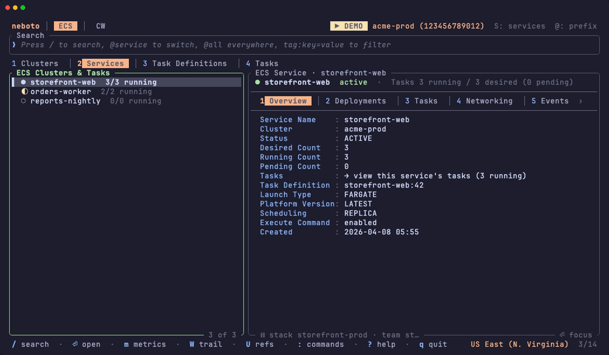
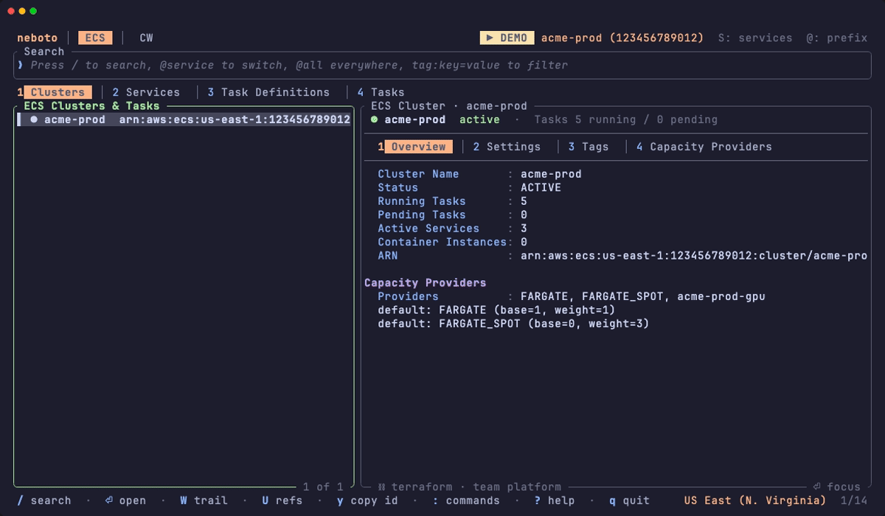
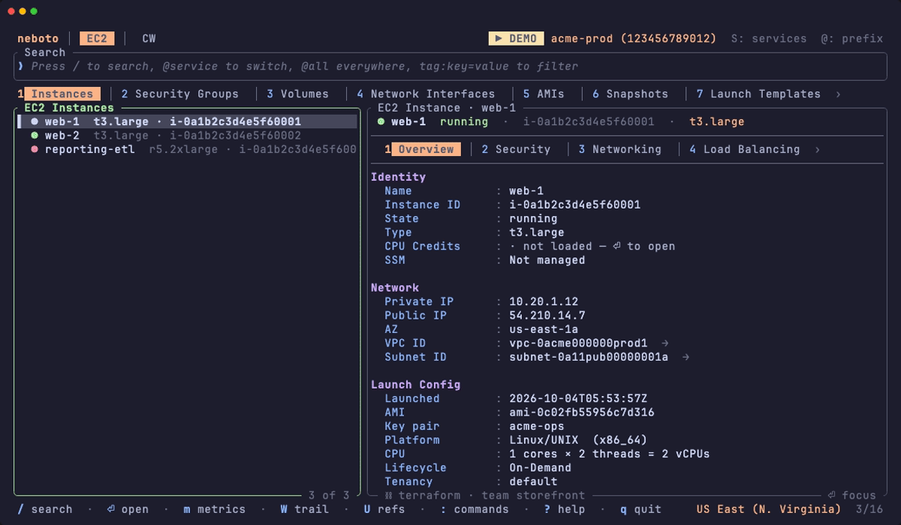
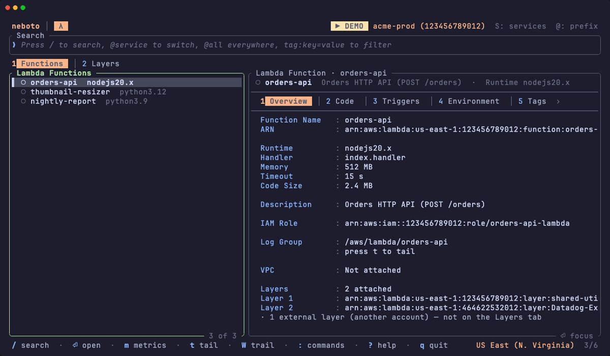
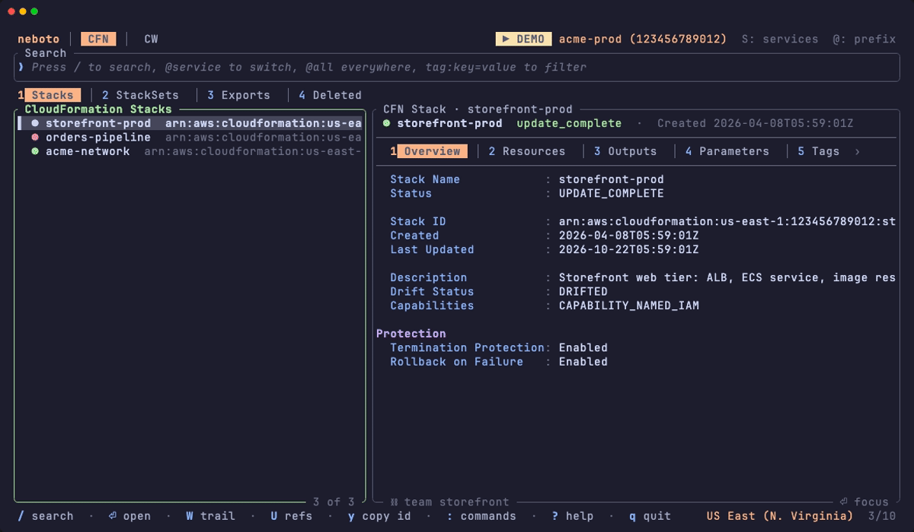
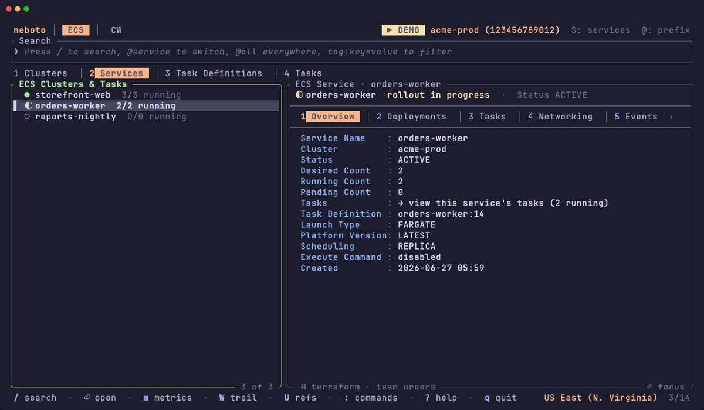

# neboto

A fast, keyboard-driven terminal UI for browsing AWS. **80 services**, rich
console-style detail panes, live log tailing, CloudWatch charts, and
cross-service link-following — all without leaving the terminal.

Built in Rust with [Ratatui](https://ratatui.rs/). Website and guide:
**[neboto.dev](https://neboto.dev)**.

<p align="center">
  
</p>

<p align="center"><em>Recorded with <code>neboto --demo</code>. Nothing on screen is a real account.</em></p>

**Try it without an AWS account:** `neboto --demo` opens a made-up account
with a few problems planted in it (a failed ECS deploy, SSH open to the world,
a drifted CloudFormation stack) and makes no network calls.

**neboto is read-only.** It issues only `describe`/`list`/`get` calls. Nothing
it does can change your account, which is the point: it is safe to run against
production, and the IAM policy in [`PERMISSIONS.md`](./PERMISSIONS.md) is
auditably read-only. See [Why read-only](#why-read-only).

---

## Install

Prebuilt binaries for Linux (x86_64, aarch64) and macOS (Intel, Apple
Silicon). The installer picks the right one, verifies its SHA-256 and (when
the GitHub CLI is installed) its signed build provenance, and puts it in
`~/.local/bin`:

```bash
curl -fsSL https://raw.githubusercontent.com/neboto/neboto-tui/main/install.sh | sh
```

Or with [cargo-binstall](https://github.com/cargo-bins/cargo-binstall):

```bash
cargo binstall --git https://github.com/neboto/neboto-tui neboto
```

Or from source with a recent stable Rust: `cargo install --git
https://github.com/neboto/neboto-tui`. Tarballs are on the
[releases page](https://github.com/neboto/neboto-tui/releases). Pinning a
version, verifying a download and the other options are in the
[install guide](https://neboto.dev/guide/install/).

You need configured AWS credentials (the standard chain: env vars,
`~/.aws/config` with SSO or roles, instance role). Optional: the `aws` CLI and
`session-manager-plugin` for SSM sessions, and a `$EDITOR` for `e`.

---

## Highlights

- **80 AWS services** behind an `@prefix` fuzzy search — `@ec2 web`, `@sh`,
  `@orgs`. Multi-resource services get numbered sub-tabs. `@all` (or `@*`)
  searches everything already loaded.
- **Console-style split detail panes** on 200+ resource types: fixed header,
  section tabs, scrollable body. Expensive sections load lazily on first view.
- **Follow the links** — press `Enter` on any ARN, id or reference to jump to
  that resource, across services and even across regions.
- **Live log tail** (`t`) and server-side **log search** (`f`) on log groups,
  Lambda, RDS, ECS tasks, WAF, CloudTrail, Step Functions, CodeBuild and more.
- **CloudWatch charts in the pane** (`m`) for 50+ resource kinds, with recent
  changes marked on the chart.
- **"What changed around this?"** (`W`) — a timeline on any resource that
  merges CloudTrail, alarm history, CloudFormation events, ECS deployments,
  Auto Scaling activities and RDS events.
- **Who uses this?** (`U`) lists the loaded resources that reference it, and
  **what can reach it?** (`N`) shows the effective security group and NACL
  rules in one table.
- **A security pass** (`@audit`) over what's loaded: open security groups,
  public buckets, unencrypted volumes, root MFA and more.
- **Multi-account** — switch profiles (`P`), or assume a role into an
  Organizations member account (`s`) under a `ReadOnlyAccess` session policy.
- **Watch mode** (`w`), **macros** (`,`), **bookmarks** (`B`), **split out**
  (`|`) into a second pane, **10 themes**, and **export** to JSON, CSV or
  Markdown.

## See it in action

Each clip is one workflow against `neboto --demo`. Click for full size.

<table>
  <tr>
    <td width="50%"><a href="demo/scenes/follow-links.gif"></a><br><b>Follow the links.</b> <kbd>Enter</kbd> from an ECS service to its target group and load balancer, <kbd>Ctrl-O</kbd> back, then <kbd>N</kbd> for the service's effective network access.</td>
    <td width="50%"><a href="demo/scenes/who-changed.gif"></a><br><b>Who changed this?</b> SSH is open to the world; <kbd>W</kbd> shows who opened it and when.</td>
  </tr>
  <tr>
    <td width="50%"><a href="demo/scenes/lambda-tail.gif"></a><br><b>Tail the logs.</b> <kbd>t</kbd> live-tails a Lambda; <kbd>/</kbd> filters to the DynamoDB throttles.</td>
    <td width="50%"><a href="demo/scenes/stack-drift.gif"></a><br><b>Explain the drift.</b> A stack's Drift section names the changed property; <kbd>W</kbd> on that resource finds the console edit.</td>
  </tr>
  <tr>
    <td width="50%"><a href="demo/scenes/metrics.gif"></a><br><b>Chart it.</b> <kbd>m</kbd> charts a service with its changes drawn in; <kbd>W</kbd> opens them and <kbd>Esc</kbd> comes back. <kbd>s</kbd> cycles the statistic, <kbd>5</kbd> is the last 30 days.</td>
    <td width="50%"></td>
  </tr>
</table>

---

## Getting around

`?` opens the in-app help, the authoritative keymap; type to filter it
(`log`, `copy`, `mouse`), and its **Here** section lists what works on the
selected resource. `:` runs any key by name. The status bar shows the keys
that matter right now. Everything on screen that names a key can also be
clicked. The essentials:

| Key | Action |
|---|---|
| `@` / `/` | Switch service / fuzzy search the current one |
| `S` / `R` / `P` | Service / region / profile picker |
| `j` `k`, `Tab`, `1`–`9` | Move, switch sub-tab (list) or section (detail pane) |
| `l` `⏎` / `h` `Esc` | Into the detail pane, follow a link / back to the list |
| `⌫` `Ctrl-O` / `Ctrl-F` | Back / forward through history |
| `m` `t` `W` `U` `N` | Charts, log tail, change timeline, referenced by, network access |
| `o` | Browse contents: S3 objects, DynamoDB items, AgentCore memory |
| `y` / `C` | Copy the id or row / copy an AWS CLI command for the resource |
| `O` | Open in the AWS Console |
| `r` / `w` | Refresh / watch mode |

The full keymap, mouse, search syntax (`tag:env=prod`, pasted ARNs, `@all`)
and split-out are in the guide:
[navigation](https://neboto.dev/guide/navigation/) ·
[search](https://neboto.dev/guide/search/) ·
[lenses](https://neboto.dev/guide/lenses/) ·
[browsers](https://neboto.dev/guide/browsers/) ·
[multi-account](https://neboto.dev/guide/multi-account/).

### Command line

Every flag overrides the config file for that run only.

| Flag | Effect |
|---|---|
| `-s`, `--service <SERVICE>` | Open a service on startup (`ec2`, `s3`, `@cw`, …) |
| `-r`, `--region` / `-p`, `--profile` | Start in this region / with this AWS profile |
| `-w`, `--watch` | Start in watch mode (auto-refresh) |
| `-m`, `--macro <NAME>` / `--bookmark <NAME>` | Run a saved macro / open at a saved bookmark |
| `--theme <THEME>` | Color preset |
| `--show-keys` | Show each key and what it did, for recordings and screen shares |
| `--session-launch <MODE>` | Where SSM / ECS Exec sessions open: `auto`, `window` or `inline` |
| `--endpoint-url <URL>` | Point at a local emulator (floci, LocalStack) |
| `--demo` | Browse a made-up account offline |
| `--no-update-check` / `--banner` / `--no-banner` | Skip the daily release check / show or hide the banner |

`neboto open` starts the TUI on one resource, focused in its detail pane:

```bash
neboto open ec2 sg-0abc123 --section inbound    # a section, any case
neboto open rds prod-main --charts 24h --full   # its charts, full width
neboto open arn:aws:iam::123456789012:role/app  # an ARN alone: the service is inferred
```

[`scripts/tmux-metrics.sh`](./scripts/tmux-metrics.sh) and
[`tmux-metrics-grid.sh`](./scripts/tmux-metrics-grid.sh) build tmux windows
from these: a detail pane beside its charts, or one pane per metric.

### Configuration

Optional TOML at `$NEBOTO_CONFIG`, `~/.config/neboto/config.toml` or
`~/.neboto.toml`. Every key is listed in [`docs/CONFIG.md`](./docs/CONFIG.md),
with a commented template in [`config.example.toml`](./config.example.toml).
A bad value warns at startup and is never fatal.

The one request neboto makes that isn't to AWS is a daily anonymous check of
GitHub for a newer release, which shows an `↑ vX.Y.Z` chip. It sends nothing
about you or your account; turn it off with `update_check = false`,
`--no-update-check` or `NEBOTO_NO_UPDATE_CHECK=1`.

---

## Services

Grouped as the Console groups them. `S` opens a picker with the same grouping,
and `neboto services` prints every prefix.

| Category | Services (`@prefix`) |
|---|---|
| **Compute** | EC2 `@ec2` · Lambda `@lambda` · Auto Scaling `@asg` · Batch `@batch` · Elastic Beanstalk `@eb` · WorkSpaces `@workspaces` |
| **Containers** | ECS `@ecs` · EKS `@eks` · ECR `@ecr` |
| **Storage** | S3 `@s3` · S3 Files `@s3files` · S3 Tables `@s3tables` · EFS `@efs` · FSx `@fsx` · Backup `@backup` · Transfer Family `@transfer` · DataSync `@datasync` |
| **Database** | RDS `@rds` · DynamoDB `@ddb` · ElastiCache `@elasticache` · DMS `@dms` · DocumentDB `@docdb` · Neptune `@neptune` |
| **Networking & Content Delivery** | VPC `@vpc` · ELB `@elb` · Route 53 `@r53` · Route 53 Resolver `@resolver` · Route 53 Profiles `@profiles` · CloudFront `@cloudfront` · Transit Gateway `@tgw` · Direct Connect `@dx` · Global Accelerator `@ga` · API Gateway `@apigw` |
| **Security & Identity** | IAM `@iam` · Identity Center `@idc` · Cognito `@cognito` · KMS `@kms` · Secrets Manager `@secrets` · ACM `@acm` · WAF `@waf` · Network Firewall `@anfw` · GuardDuty `@gd` · Security Hub `@sh` · Inspector `@inspector` · Firewall Manager `@fms` · Audit `@audit` (findings from loaded data) |
| **Analytics** | Athena `@athena` · Glue `@glue` · Kinesis `@kinesis` · MSK `@msk` · Redshift `@redshift` · OpenSearch `@opensearch` |
| **ML & AI** | Bedrock `@bedrock` · Bedrock AgentCore `@agentcore` |
| **App Integration** | SQS/SNS `@sqs` · EventBridge `@events` · Step Functions `@sfn` · SES `@ses` · AppSync `@appsync` · Amazon MQ `@mq` |
| **Management & Governance** | CloudFormation `@cfn` · CloudWatch `@cw` · X-Ray `@xray` · Changes `@changes` (what changed recently, account-wide) · CloudTrail `@cloudtrail` · AWS Config `@config` · Systems Manager `@ssm` · Organizations `@orgs` · Trusted Advisor `@ta` · Health `@health` · Service Quotas `@quotas` · Resource Explorer `@explorer` · Resource Groups `@resourcegroups` · RAM `@ram` · Control Tower `@controltower` · Service Catalog `@sc` |
| **Developer Tools** | CodeSuite `@code` (CodeCommit, CodeBuild, CodePipeline) |
| **Cost Management** | Cost Explorer `@cost` · Budgets `@budgets` · Invoices `@invoices` |

> **Cost note:** `@cost` uses AWS Cost Explorer, which bills ~$0.01 per API
> request and lags ~24h. neboto caches it for 6h; `r` forces a refresh.

---

## Why read-only

A design constraint, not a missing feature:

1. The Organizations member-account switch pins assumed sessions to a
   `ReadOnlyAccess` session policy. Write actions would either fail
   cross-account or force that guarantee to be weakened.
2. A purely read-only footprint is a trust asset: security teams can approve
   neboto precisely *because* it cannot mutate.

**Permissions.** The AWS-managed `ReadOnlyAccess` policy covers everything.
[`PERMISSIONS.md`](./PERMISSIONS.md) lists the exact actions per service for a
narrower grant, and flags the few worth a second look (secret reveals, calls
that cost money, the role switch).

**Check it yourself in CloudTrail.** Every request carries `app/neboto` in its
user agent; in CloudTrail Lake or Athena, filter on `userAgent LIKE
'%app/neboto%'` and every row should be `readOnly = true`.

**When you do want a change**, `C` copies the ready-to-run AWS CLI command
(stop an instance, force an ECS redeploy, scale a group) with the region,
profile and ids filled in. Destructive commands are left out, and neboto never
runs them.

**The one exception is sessions.** `s` on an instance or ECS task opens an SSM
or ECS Exec shell through the `aws` CLI. It's always your keypress and changes
no resource, but a shell can change anything on the box; it's off while an Org
member role is assumed. On your own credentials the guarantee is enforced by
the code and a CI check, so for a hard boundary run neboto on a read-only
profile (and deny `ssm:StartSession` / `ecs:ExecuteCommand` if you don't want
shells). More in the [permissions guide](https://neboto.dev/guide/permissions/).

---

## Scripts and agents

Subcommands that run once and print instead of opening the TUI. They make the
same read-only calls, so they're safe to hand to a script or an AI agent.

```sh
neboto ls @ec2 -t volume --state available        # unattached EBS volumes
neboto ls @ecs -f 'tag:team=storefront' -o md     # a Markdown table
neboto ls @rds --regions=us-east-1,eu-west-1      # across regions
neboto get @iam deploy-role --section permissions -o json
neboto audit --fail-on high -o json               # gate CI on high severity
```

JSON carries `"schema": "neboto/v1"`, and its envelope, section names and exit
codes are a pinned contract. Flags, output shapes and recipes (diffing two
resources across accounts) are in the [CLI guide](https://neboto.dev/guide/cli/)
and [`docs/HEADLESS.md`](./docs/HEADLESS.md).
[`skills/neboto/SKILL.md`](skills/neboto/SKILL.md) teaches an agent the
commands; for Claude Code, copy it to `~/.claude/skills/neboto/SKILL.md`.

---

## Contributing

Contributions are welcome. [`CONTRIBUTING.md`](./CONTRIBUTING.md) has the
house rules and how to build and test (`cargo test` needs no AWS credentials
or network), [`CLAUDE.md`](./CLAUDE.md) the architecture tour,
[`docs/adr/`](./docs/adr) the design decisions, and
[`SECURITY.md`](./SECURITY.md) how to report a vulnerability. Open work is in
[GitHub Issues](https://github.com/neboto/neboto-tui/issues).

## License

MIT — see [LICENSE](./LICENSE).
